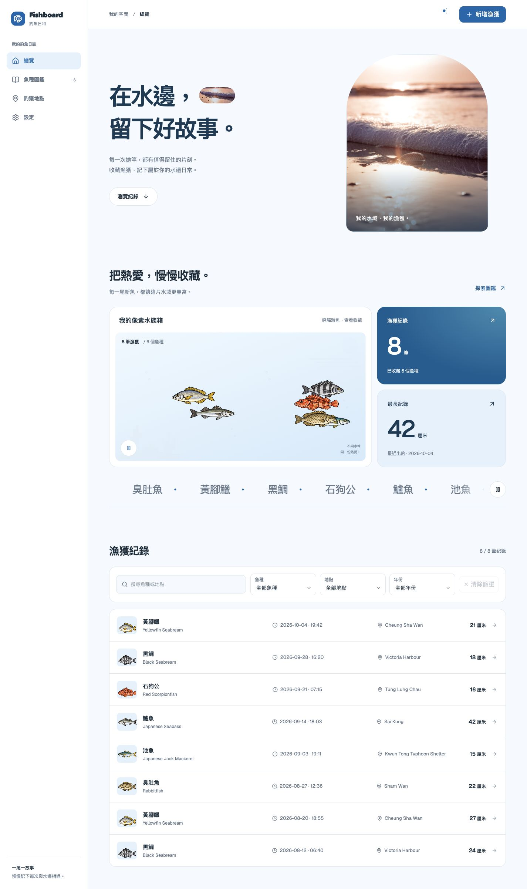
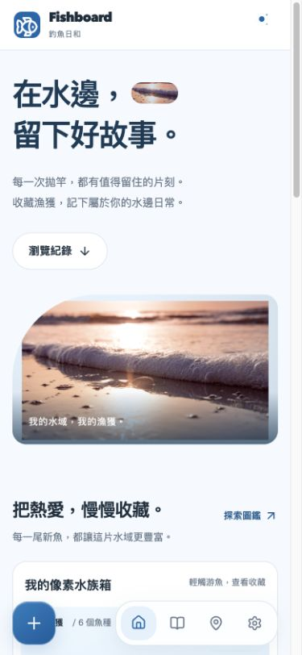
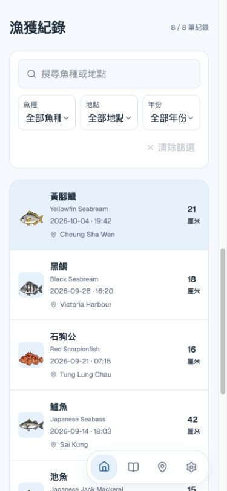
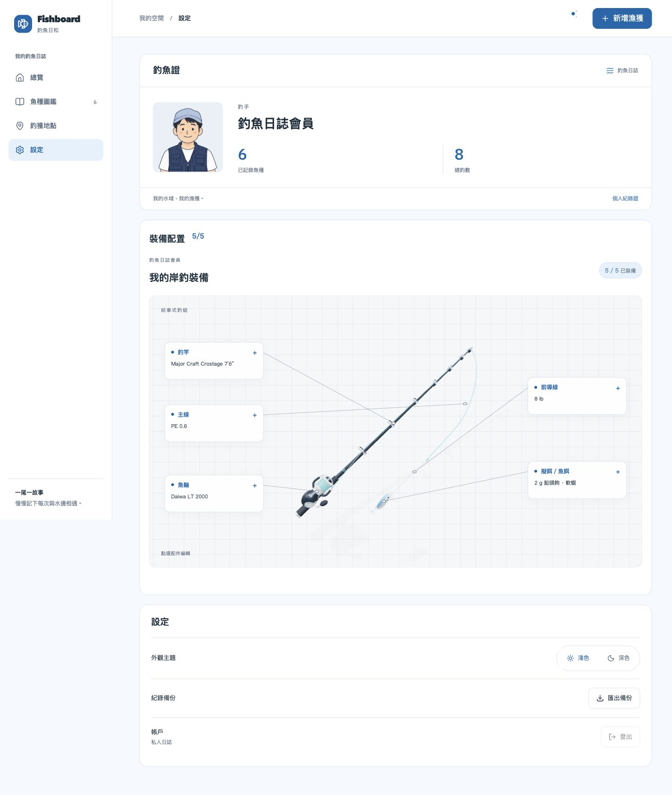

# Fishboard · 釣魚日和

以藍白色系呈現的私人釣魚日誌。記下每次漁獲、收藏像素魚種、重訪釣獲地點，並保存自己的 Three.js 釣組配置。支援桌面、手機及深淺色主題。

## 3D 小島首頁與原有日誌

首頁 `/` 使用 Three.js 小島、原創 low-poly 釣手、WASD／點地行走及站點互動。手機有左下 360° 搖桿、啟動拉近人物及跟隨鏡頭；桌面維持全島視角並隱藏搖桿。減少動態時直接進入近鏡。遊戲畫面防止誤選文字，原有內容頁可正常輸入及複製。

`2fb5496` 原有主頁完整保留於 `/journal`，包括海岸主視覺、水族箱、收藏摘要、魚種跑馬燈及漁獲列表。小島入口以全頁 popup 開啟同一套現有內容與資料服務（不跳頁）：

| 小島站點 | 原有功能 |
| --- | --- |
| 水族箱 | `/journal#collection-title`：已儲存像素魚與圖鑑連結 |
| 日誌桌 | `/journal#catch-log`：紀錄、搜尋、篩選及 catch detail |
| 紅色工具箱 | `/add`：原有相片上載、AI 生圖及新增流程 |
| 地圖板 | `/map`：按 marker 篩選已有紀錄 |
| 小屋 | `/settings`：帳戶、設定與 Three.js loadout |

站點開啟全螢幕原生 dialog，小島保持掛載並暫停。Popup 沿用原有 Shell、登入、資料與共用 loading provider；內部圖鑑、catch detail、新增及編輯都留在 popup，提供內部返回與關閉。儲存／生圖期間禁止關閉；新增完成會在 popup 顯示原有 catch detail。關閉後回到原本人物位置，網址不變。`/#catch-log` 舊連結會直接打開日誌 popup。原有獨立頁面仍可透過原網址使用。

角色模型來源為 `art/character/build-island-angler.mjs`，使用既有 Three.js，`npm run build:character` 可重新輸出 `public/models/island-angler.glb`。細節與整合邊界見 [3D 小島整合說明](docs/design/island-integration.md)。

## 畫面

2026-10-13 日誌版截圖。以下是保留的日誌 UI 元件使用 repo 內示範資料的本機截圖，沒有私人帳戶資料；截圖不代表真實帳戶或實體手機驗收。

### 桌面漁獲日誌

主視覺 → 水族箱與收藏摘要 → 漁獲紀錄。主頁在紀錄列表結束；「新增漁獲」集中在導覽列。



### 手機日誌與紀錄

左下新增按鈕與右下導覽項目分開（現已新增返回小島入口）。向下捲動時，新增按鈕向左收起；紀錄保留魚種、日期、地點與長度。

<p>
  
  
</p>

### 設定與 Three.js loadout

裝備配置放在設定頁，保留真實 3D 模型與五個可編輯配件。



## 功能

- **漁獲紀錄**：新增、編輯及刪除漁獲；保存原相、日期／時段、地點、尺寸、備註與裝備快照。刪除須確認。
- **搜尋與篩選**：搜尋魚種或地點，組合魚種、地點及年份篩選，顯示結果數量並支援清除。
- **像素水族箱**：每個已釣獲魚種只入住一尾魚；選取查看收藏資料，可暫停游魚，尊重減少動態設定。
- **魚種圖鑑**：查看魚種資料、釣獲次數、最長紀錄與釣獲歷史。重複釣獲共用同一魚種。
- **釣獲地圖**：MapLibre／OpenFreeMap 地圖。點選 marker 才篩選該位置漁獲；同名但不同座標的位置分開，支援「顯示全部」。
- **3D 裝備**：設定頁內編輯釣竿、魚輪、主線、前導線及擬餌／魚餌；hover、focus 或選取可高亮配件。只有未儲存改動才顯示儲存提示。
- **照片與像素魚**：新魚種以原相產生透明像素魚；已收藏魚種再新增漁獲會沿用現有像素魚。
- **私人帳戶**：Google 登入、按使用者分隔的資料與圖片、JSON 備份匯出。
- **響應式 UI**：桌面側欄、手機分離式動畫導覽、深淺色主題。頁面使用靜態底色，水族箱游魚及 3D 釣組保留。

新增漁獲會保存當時的裝備快照；後續修改個人 loadout 不會改寫舊漁獲。

## 頁面

| 頁面 | 路徑 |
| --- | --- |
| 主頁／漁獲紀錄 | `/`、`/#catch-log` |
| 魚種圖鑑 | `/collection` |
| 魚種詳情 | `/species/[id]` |
| 漁獲詳情 | `/catches/[id]` |
| 釣獲地圖 | `/map` |
| 設定／裝備配置 | `/settings`、`/settings#loadout` |
| 新增漁獲直接入口 | `/add` |

訪客先看到 Google 登入頁。導覽沒有獨立 loadout 頁；舊 `/gear` 連結重新導向 `/settings#loadout`。

## 技術架構

| 部分 | 實作 |
| --- | --- |
| 網頁 | React、TypeScript、Next.js／Vinext |
| UI 與動態 | CSS、Geist、Framer Motion、GSAP ScrollTrigger |
| 水族箱／裝備 | 2D 像素游魚、Three.js GLB 釣組 |
| 地圖 | MapLibre GL、OpenFreeMap |
| 登入／紀錄 | Firebase Google Auth、Firestore REST |
| 私人圖片 | Cloudinary authenticated storage，經檢查擁有者的圖片 API 讀取 |
| 像素魚生成 | Cloudflare Workers AI；Vercel 使用 REST，Cloudflare 可使用原生 binding |
| 部署 | Vercel 的 Next.js build；另保留 Cloudflare／Vinext 設定 |

目前首頁使用 `components/fishlog/` 的日誌介面。舊 D1／R2／OpenAI collection 仍保留為 legacy 程式碼，不是目前首頁；舊資料的遷移規則見服務文件。

## 本機開發

需要 Node.js **22.13 或以上**。

```sh
npm ci
cp .env.example .dev.vars
```

在本機 `.dev.vars` 填寫 Firebase 公開登入設定、Firestore 服務帳戶及 Cloudinary 伺服器設定。`FISHBOARD_ORIGIN` 必須與開啟網站的 scheme、hostname 和 port 完全一致；範例使用 `http://127.0.0.1:5173`。

```sh
npm run dev
```

本機預設使用 Vinext，通常在 port 5173 啟動；以終端印出的網址為準。Google Authentication 亦須授權該 hostname。新日誌使用真正的 Firebase 登入，沒有以 Sites 模擬登入替代私人帳戶。

像素魚生成另需 Workers AI 設定及 `GENERATION_ENABLED=true`。開發時使用原生遠端 AI binding 的方式、REST 設定、服務權限及完整驗收步驟，見 [服務設定](docs/service-setup.md)。AI 推論、圖片儲存及傳送可能產生服務用量費用；未設定生成服務時，不會虛構像素魚。

Vercel 使用相同名稱的 server environment variables；本機 Next.js 環境可放在忽略的 `.env.local`。伺服器私鑰與 token 不可使用 `NEXT_PUBLIC_`，也不要提交 `.dev.vars`、`.env.local` 或憑證檔案。

## 建置與檢查

```sh
npm test
npx tsc --noEmit
npm run lint
```

Vercel 的正式建置與 `vercel.json` 一致：

```sh
npm run build:vercel
```

Cloudflare／Vinext 建置保留以下入口：

```sh
npm run build
```

測試涵蓋漁獲驗證及篩選、主頁範圍、手機導覽捲動、游魚範圍、GLB 配件、裝備儲存、地點觸控選取、圖片處理、帳戶隔離與儲存失敗復原。自動測試與本機截圖不等同線上服務或實體手機驗收。

## 文件

- [UI 設計與互動規格](docs/design/fishboard-ui-design.md)
- [全站 UI audit 與主頁調整](docs/design/2026-10-13-ui-audit.md)
- [服務設定、歷次驗證與部署](docs/service-setup.md)
- [游魚行為規格](docs/design/swimming-behaviour.md)
- [海岸照片來源與授權](public/fish/landing-coast-credit.txt)

README 截圖放在 `docs/screenshots/`，尺寸及擷取方式見 [截圖說明](docs/screenshots/README.md)。
